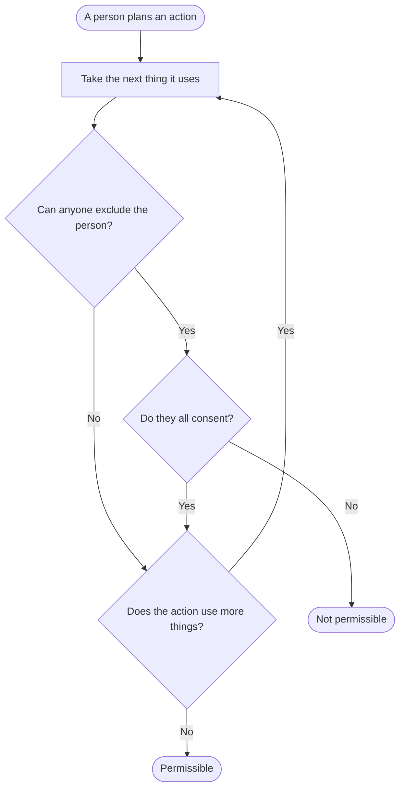
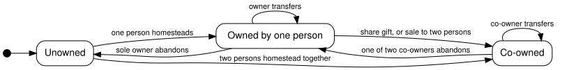
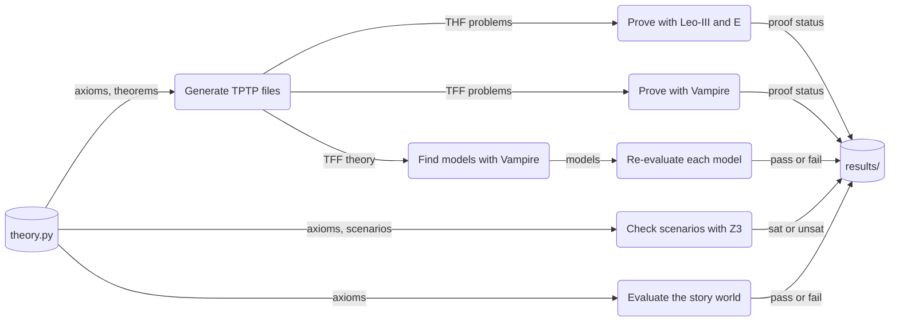

# Libertarian Property Theory — v0.23

This project states the libertarian theory of property as a set of axioms in formal logic. Computer programs check the axioms in two ways. Provers derive theorems from the axioms. Model finders build small worlds in which every axiom is true.

The theory starts from one idea: **to own a thing is to have the right to exclude other persons from it**. The theory does not give an owner a right to use the thing. From this idea, the theory derives the rules of homesteading, gifts, sales, leases, easements, abandonment, aggression and defence.

This file describes the axioms, the theorems and the models. It does not argue for the theory. The case against the claim that co-ownership is a contradiction is in [ARGUMENT.md](ARGUMENT.md).

## Results in brief

- **The theory is consistent.** Three independent methods find models of all the axioms (see [Is there a model?](#is-there-a-model)).
- **Co-ownership has models.** In these models, two persons own the same field, each refuses the other every use, they want uses that clash, and nobody commits aggression. The field stays unused. This is a deadlock (`joint_deadlock`).
- **Two opposing premises produce a contradiction with co-ownership.** The project states them as contrast axioms, which are not part of the theory:
  - The **control view**: an owner may use his property in any manner. Nobody else may use it in a way that clashes with what he wants. With these two axioms, co-owners of a scarce thing can never want clashing uses (`control_coownership_contradiction`).
  - The **direction view**: every conflict over a thing has a winner by right. The winner's use is permitted, and the other party's use is forbidden. With this axiom, an owner can never refuse two rivals (`direction_overreach`), and co-owners can never deadlock (`direction_forbids_deadlock`).
- **Veto co-ownership settles conflicts; free use does not.** When co-owners hold titles against each other, two of their uses are both permitted only if each consents to the other's (`veto_settles_conflict`). When co-owners hold titles against outsiders only, as is usual in law, two clashing uses are both permitted and at most one can happen (`free_use_unsettled`).
- **Control is a result of sole ownership.** A sole full owner controls his property (`sole_owner_controls`). A co-owner controls the thing only if the other co-owners consent to every use he makes (`control_needs_deference`).
- **55 theorems** have proofs from two different provers. Each proof uses only a declared list of axioms.

## Basic terms

The documentation uses each term below in one meaning only. The file [docs/glossary.toml](docs/glossary.toml) lists all terms.

- **Person**: someone who can act, use things, claim, consent and hold titles.
- **Object**: a thing that is not a person, for example a field, a knife or a song.
- **Body**: a person considered as a thing that someone can use.
- **Instant**: a point in time. The relation "before" orders the instants.
- **Manner**: a way of using a thing, for example plow, sow or walk.
- **Clash**: two uses of a thing clash when two different use events in those manners cannot happen at the same instant. Two persons cannot plow the same field at the same instant.
- **Scarce**: a thing is scarce when some two uses of it clash. A field is scarce. A song is not scarce, because any number of persons can sing it at once.
- **Title**: the right of one person to exclude one other person from using one thing in one manner. A title names two persons and a manner.
- **Full owner**: a person who holds a title against every other person, in every manner, over a thing.
- **Co-owners**: two or more full owners of the same thing at the same instant. Each holds a title against the others.
- **Owner**: a person who holds at least one title over a thing. A full owner is an owner; a tenant is also an owner, of the manners that he leases.
- **Unowned**: nobody holds a title over the thing.
- **Consent**: an owner consents to one person using a thing in one manner at one instant.
- **Permitted**: a use is permitted when every person who holds an unforfeited title against the user, over that thing and in that manner, consents.
- **Aggression**: a use of a thing without the consent of a title holder. The holder has an unforfeited title against the user, over that thing, in that manner.
- **Forfeit**: an aggressor forfeits some titles while he aggresses. With respect to his victim, he loses his titles over his own body and over the things that he uses in the aggression.
- **Homestead**: to use and claim a scarce unowned object.
- **Grant**: an owner gives another person one title over an object and keeps his own titles. The grant takes effect only if the other person accepts it.
- **Share gift**: an owner grants another person, in every manner, every title that he holds and a title against himself.
- **Transfer**: a share gift and an abandonment at the same instant. The former owner keeps nothing.
- **Lease**: an owner transfers his titles in some manners only. The tenant then holds the titles in those manners; the landlord keeps the titles in all other manners.
- **Easement**: an owner releases one person from one manner, for example from walking across a field.
- **Release**: an owner gives up one title.
- **Abandon**: an owner releases every title that he holds over an object.
- **Control**: a person controls a thing when he may use it in every manner and each other person may use it exactly when he consents.

## How the theory works

### A title is a relation between two persons and a manner

The basic statement of the theory is "Ada may exclude Ben from sowing the field at instant t1". In the formal language, this is `owns(ada, field, ben, sow, t1)`. Ownership in the usual sense is a pattern of these titles. A full owner holds a title against every other person in every manner (`full_owner_def`). Full ownership, co-ownership, leases and easements are all patterns of single titles.

### One rule decides every permission

The theory has one rule for the use of things. A person may use a thing in a manner unless a title holder refuses. The title holder must hold an unforfeited title against that person, over that thing, in that manner. The formal definition is `may_use_def`:

```
may_use(Q,O,M,T) <=> ![R]: ((owns(R,O,Q,M,T) & ~ forfeits(R,O,Q,T)) => consents(R,O,Q,M,T))
```

The theory has no separate rules for theft, trespass, assault or the use of unowned things. These cases follow from the one rule:

- Nobody holds a title over an unowned thing. So anyone may use it (`unowned_use`).
- Nobody holds a title against himself. So an owner never needs his own consent (`no_self_exclusion`).
- A co-owner needs the consent of each other co-owner (`co_owner_use_by_consent`).
- An owner can be forbidden to use his own property, if a co-owner refuses (scenario `owner_may_be_forbidden`).
- A person who holds no title may use a thing when the owners consent (scenario `non_owner_may_use`).

So ownership does not decide whether a use is permitted. Ownership decides only whose consent the user needs.

An action can use several things at once. A stab uses the knife and the body of the victim. The action is permissible only if each use is permitted. Figure 1 shows the test.



*Figure 1. Is an action permissible? "Exclude" means: hold an unforfeited title against the person over that thing, in the manner of the action. An action that is not permissible is aggression if the person does it.*

This test is the formal content of the saying "your fist ends where my nose begins". The titles of other persons limit the use of your own property. The theorem `ownership_is_not_licence` states it. A person may use his own knife, but an action that also uses another person's body without consent is aggression.

### Defence of property

An owner may protect his property. While a person aggresses against an owner, he forfeits some titles with respect to that owner (`forfeits_def`). He forfeits his titles over his own body and over the things that he uses in the aggression. The owner may then use them without consent, and this use is not aggression (`defence_is_not_aggression`).

For example, Cy walks across Ada's field without her consent, and Ada pushes him off. The push uses Cy's body without his consent. Because Cy is aggressing against Ada at that instant, Cy has forfeited his title against Ada over his body. So the push is not aggression (scenario `self_defence`).

The rule does not measure proportion. While the aggression lasts, the victim may use the aggressor's body in any manner. The rule also does not say who started a fight. If two persons each use only the other's body, the theory proves that exactly one of them is the aggressor (`fight_one_aggressor`). Which one is a fact about the history that the theory does not record.

### Scarcity is the reason for titles

The theory describes physical facts with the relation **clash**. If plowing clashes with plowing on a field, two persons cannot plow the field at the same instant. One person alone can plow it.

Clashes cause conflict. When one person uses a scarce thing, a second person who wants a clashing use cannot have that use (`rival_wants_unrealised`). Titles decide such conflicts in advance. A thing with no clashing uses causes no conflict. The theory therefore never gives titles over things that are not scarce, such as ideas and songs (`nonrivalrous_unowned`, `nonrival_use_free`).

### How titles start and end

A title over an object starts in one of two ways:

1. **Homestead.** A person uses and claims a scarce unowned object. At every later instant, that person holds a title against every other person, in every manner. He is a full owner (`homesteader_full_owner`).
2. **Accepted grant.** An owner grants a title to another person, and that person accepts it. The grant is effective only for a title that the owner holds, or for a title against the owner himself. At every later instant, the grantee holds the granted title. The owner keeps his own titles.

Apart from homesteading, nobody acquires a title without accepting it (`no_title_without_acceptance`). A title lasts until its holder releases it. The axiom `title_genesis` closes the list: a title over an object exists only because of an earlier homestead or accepted grant. From this closure, the theory derives the following:

- A title does not appear from nothing (scenario `ex_nihilo_title`).
- A grant of a title that the owner does not hold gives nothing (`nemo_dat`).
- After a transfer, the former owner can grant nothing more, so he cannot sell the thing twice (`no_double_spend`).
- After the only owner abandons a thing, the thing is unowned again (`res_nullius`).
- Anyone, the former owner included, can then homestead it again (`life_cycle`).

### Gifts, sales, leases and easements

Gifts, sales and leases are combinations of grants and releases. The theory defines them and needs no separate axioms for them:

- **Share gift.** A full owner grants another person every title that he holds and a title against himself. Both are then full owners: co-owners (`share_gift`).
- **Transfer.** A share gift and an abandonment at the same instant. The new owner holds each title that the former owner held (`transferee_owns`).
- **Joint purchase.** Two transfers by one owner at the same instant, to two buyers. The buyers become co-owners (`joint_purchase`).
- **Lease.** A transfer of the titles in some manners only. The tenant may exclude the landlord from those manners (`lease_tenant_excludes_landlord`). The landlord holds no title in those manners during the lease, and keeps his titles in all other manners (`lessor_loses_manner`, scenario `lease`).
- **Easement.** An owner releases one person from one manner. That person may then use the thing in that manner without asking. The owner may still forbid all other uses (`easement_use`, scenario `easement`).

Co-ownership thus starts in four ways, and none of them needs a special axiom:

- a joint homestead (`joint_homesteading`);
- a share gift;
- a joint purchase;
- the transfer of a co-owner's share to a third person (MODEL.md, at t2).



*Figure 2. The states of an object and the events that change them. A co-owner who transfers gives his place among the co-owners to the new owner. A lease divides the titles by manner and is not shown.*

### Persons

Every person holds a title over his own body against every other person, in every manner, at every instant (`self_ownership`). No person can hold a title over another person (`person_unownable`). Nobody can grant a title over a body (`voluntary_slavery_impossible`). Use of another person's body without consent is aggression, unless that person is aggressing against the user at that instant (`bodily_integrity`).

### Control

A person controls a thing when he may use it in every manner and each other person may use it exactly when he consents (`controls_def`). Control is not part of the definition of ownership. It is a consequence of one pattern of titles:

- A sole full owner who is not aggressing against anyone controls his property (`sole_owner_controls`).
- A co-owner controls the thing only if every other co-owner consents to every use that he makes (`control_needs_deference`).
- When two co-owners hold the only titles against a third person, that person may use the thing exactly when both consent (`unanimity`).

### Two forms of co-ownership

The theory can describe two forms of co-ownership. In the **veto form**, each co-owner is a full owner. He holds a title against every other person, and the other co-owners are included. Two uses by co-owners are then both permitted only if each consents to the use of the other (`veto_settles_conflict`). So the titles settle every conflict between co-owners.

In the **free-use form**, the co-owners hold titles against outsiders only. This is the usual form in law. Two clashing uses by the co-owners are then both permitted, but at most one of them can happen (`free_use_unsettled`). The titles do not settle which use goes ahead. Two scenarios show both outcomes, each with no aggression (`free_use_ada_acts_first`, `free_use_ben_acts_first`). In law, a majority rule or a court then decides. The glossary term **co-owners** refers to the veto form.

### The contrast axioms

Four contrast axioms state premises of opposing views. They are not part of the theory. The checks add them to the theory to find what follows.

| Contrast axiom | Premise | What follows when it is added |
|---|---|---|
| `control_use_liberty` | An owner may use his property in any manner. | A co-owner can never refuse another co-owner anything (`control_no_refusal`). |
| `control_protection` | Nobody else may use an owner's property in a way that clashes with what the owner wants. | With `control_use_liberty`: two co-owners of a scarce thing can never want clashing uses (`control_coownership_contradiction`). Sole ownership still has models. |
| `control_protection_outsiders` | As `control_protection`, but only against persons who hold no title over the thing. | With `control_use_liberty`: co-ownership has models, and both co-owners may make clashing uses (scenario `co_ownership_with_protection_against_outsiders`). |
| `direction_exhaustive` | Every conflict over a thing has a just victor: one party's use is permitted and the other's is forbidden. | An owner can never refuse two rivals who want clashing uses (`direction_overreach`). Co-owners can never deadlock (`direction_forbids_deadlock`). |

Without the contrast axioms, every one of these situations has a model (scenarios `co_ownership_consistent`, `owner_refuses_two_rivals`). Each control axiom alone is also consistent with co-ownership (scenarios `co_ownership_with_use_liberty_only`, `co_ownership_with_protection_only`).

## The axioms

The theory has 19 axioms and 19 definitions. A definition introduces a name and adds no claim. Two axioms follow from the others. The theory keeps them because readers expect to see them, and the provers confirm that they follow. A script generates the table from [source/theory.py](source/theory.py).

<!-- BEGIN GENERATED: axioms -->
| # | Name | Kind | In plain words |
|---|---|---|---|
| 1 | `time_irreflexive` | axiom | No instant is before itself. |
| 2 | `time_transitive` | axiom | If A is before B and B is before C, then A is before C. |
| 3 | `time_total` | axiom | Any two instants are equal or one is before the other. |
| 4 | `time_nonempty` | axiom | There are at least two instants. |
| 5 | `entity_disjoint` | axiom | Nothing is both a person and an object. |
| 6 | `two_persons` | axiom | There are at least two persons. |
| 7 | `an_object` | axiom (derived, kept for clarity) | There is at least one object. |
| 8 | `persons_rivalrous` | axiom (derived, kept for clarity) | Every body is scarce: some two uses of it clash. |
| 9 | `use_typing` | axiom | Only persons use things; what they use is an object or a body. |
| 10 | `claim_typing` | axiom | Only persons claim, and only objects are claimed. |
| 11 | `owns_typing` | axiom | A title is held by a person against another person, over an object or the holder's own body. |
| 12 | `disowns_typing` | axiom | Only a title that is actually held over an object can be released. |
| 13 | `grant_typing` | axiom | Only an owner grants, only titles over an object, and only to another person. |
| 14 | `self_ownership` | axiom | Every person holds a title over his or her body against every other person, in every manner, at every instant. |
| 15 | `nodis_upto_def` | definition | The title of P against Q over O in manner M is not released in the window [T1,T2). |
| 16 | `acquires_def` | definition | An acquisition event for a title: P homesteads O (uses and claims it while it is scarce and unowned), or P accepts a grant of the title from someone who holds it, or from Q himself. |
| 17 | `title_acquired` | axiom | After an acquisition event, the title holds at every later instant until it is released. |
| 18 | `title_genesis` | axiom | A title over an object holds only because of an earlier acquisition event that was not released since. |
| 19 | `is_owner_def` | definition | A holder of rights over O is someone who holds at least one title over O. |
| 20 | `full_owner_def` | definition | A full owner of O holds a title against every other person in every manner. |
| 21 | `unowned_def` | definition | O is unowned when nobody holds any title over it. |
| 22 | `shares_def` | definition | R shares manner M of O with P: R grants P every title in M that R holds, and a title in M against R himself. |
| 23 | `gives_share_def` | definition | A share gift: R shares every manner of O with P. R keeps his own titles. |
| 24 | `transfers_manner_def` | definition | R transfers manner M of O to P: R shares manner M with P and releases all his titles in M. A lease is such a transfer for the leased manners. |
| 25 | `vol_transfer_def` | definition | A transfer: a share gift and an abandonment at the same instant. |
| 26 | `abandons_def` | definition | To abandon is to release every title one holds over an object. |
| 27 | `may_use_def` | definition | Q may use O in manner M unless someone who holds a title against Q over O in M, and has not forfeited it, does not consent. |
| 28 | `forbidden_use_def` | definition | A use is forbidden exactly when it is not permitted. |
| 29 | `aggresses_in_def` | definition | P's action in manner M aggresses against Q when it uses something over which Q holds an unforfeited title against P in M, without Q's consent. |
| 30 | `aggresses_def` | definition | P aggresses against Q when some action of P aggresses against Q. |
| 31 | `forfeits_def` | definition | While R aggresses against Q, R forfeits, with respect to Q, his titles over his own body and over the things he uses in the aggressing action. Q may use them without R's consent. |
| 32 | `permissible_def` | definition | An action is permissible when each thing it uses may be used in that manner. |
| 33 | `controls_def` | definition | P controls O when P may use O in every manner and every other person may use O exactly when P consents. |
| 34 | `rivalrous_def` | definition | A thing is scarce when some two uses of it clash. |
| 35 | `clash_factual` | axiom | Two different use events in clashing manners do not happen at the same instant. |
| 36 | `nonrivalrous_unowned` | axiom | Things that are not scarce (ideas, patterns) are never owned. |
| 37 | `unowned_exists` | axiom | At some instant some object is unowned (there is a state of nature). |
| 38 | `unrealised_def` | definition | A want is unrealised when the wanted use does not happen. |

The contrast axioms below are not part of the theory. They state premises of the control view and the direction view, so that the checks can test their consequences.

| Name | In plain words |
|---|---|
| `control_use_liberty` | Control view: an owner may use his property in any manner. |
| `control_protection` | Control view: no other person may use an owner's property in a way that clashes with what the owner wants. |
| `control_protection_outsiders` | Weakened control view: the protection of an owner's wants runs only against persons who hold no title over the thing. |
| `direction_exhaustive` | Direction view (LiquidZulu): every conflict over the use of a thing has a just victor, whose use is permitted while the other's is forbidden. |
<!-- END GENERATED: axioms -->

## The theorems

Two provers, Vampire and Leo-III, prove each theorem below. Each proof uses only the axioms that [minimal/MANIFEST.md](minimal/MANIFEST.md) lists for that theorem. A star (★) marks the main theorems. The table omits the intermediate theorems that serve only as steps in other proofs.

<!-- BEGIN GENERATED: theorems -->
**Time**

| Theorem | In plain words | Proved |
|---|---|---|
| `endless_past_paradox` | If time has no first instant, a person cannot use and claim a scarce object at every instant without grants or releases. The title axioms need a first instant. | both provers |

**Persons**

| Theorem | In plain words | Proved |
|---|---|---|
| `person_unownable` | Nobody holds a title over another person (no slavery). | both provers |
| `no_self_exclusion` | Nobody holds a title against himself, so no owner needs his own consent. | both provers |
| `body_sole_owner` | Only you hold titles over your body. | both provers |
| `self_use` | Everyone may use his own body in any manner, as far as the body alone is concerned. | both provers |
| `bodily_integrity` | Using another person's body without consent is aggression against that person, unless that person is aggressing against the user at that instant. | both provers |
| `selective_consent` | Consent is given person by person: the same use can be permitted to one person and forbidden to another. | both provers |
| `voluntary_slavery_impossible` | Nobody can grant any title over a body, his own included (self-ownership is inalienable). | both provers |

**Titles**

| Theorem | In plain words | Proved |
|---|---|---|
| `title_persists` | A title lasts until it is released. | both provers |

**Use, consent and easements**

| Theorem | In plain words | Proved |
|---|---|---|
| `unexcluded_use` | If nobody holds a title against you over a thing in a manner, you may use it in that manner. Ownership is not needed for use. | both provers |
| `unowned_use` | Anyone may use an unowned thing. | both provers |
| `nonrival_use_free` | Anyone may use a thing that is not scarce (an idea) in any manner. | both provers |
| `theft_forbidden` | If someone who holds a title against you over a thing does not consent, your use is forbidden (unless he is aggressing against you at that instant). | both provers |
| `joint_deadlock` ★ | Co-owners who refuse each other are both forbidden. This is a deadlock, not a contradiction. | both provers |
| `co_owner_use_by_consent` | A co-owner may use the common thing when the only other person who may exclude him consents. | both provers |
| `easement_use` ★ | An easement: after an owner releases one person from one manner, that person may use the thing in that manner without asking, provided nobody else may exclude him from it. | both provers |

**Two forms of co-ownership: veto and free use**

| Theorem | In plain words | Proved |
|---|---|---|
| `free_use_unsettled` ★ | Free use (the usual legal form of co-ownership: titles against outsiders only). Two clashing uses are both permitted, but at most one can happen. The titles do not settle which one. | both provers |
| `veto_settles_conflict` ★ | Veto co-ownership (this theory's co-owners): two uses by co-owners are both permitted only if each consents to the other's. The titles settle every conflict between co-owners, in favour of an agreed use or of no use. | both provers |

**Action, aggression and defence**

| Theorem | In plain words | Proved |
|---|---|---|
| `aggression_iff_forbidden_use` | To aggress is exactly to make a forbidden use of something; every forbidden use has a victim. | both provers |
| `no_self_aggression` | Nobody aggresses against himself. | both provers |
| `ownership_is_not_licence` ★ | Your fist ends where my nose begins: P may use his own knife, but an action that also uses R's property without R's consent is aggression, and is not permissible. | both provers |
| `action_liberty` | An action is permissible if nobody holds a title against the person over anything the action uses (his own sole property, his own body, unowned things). | both provers |
| `unowned_use_innocent` | Using only unowned things never wrongs anyone. | both provers |
| `co_owner_trespass` | A co-owner who uses the common thing against the other co-owner's will aggresses against him. | both provers |
| `refraining_innocent` | Doing nothing never violates anyone's rights. | both provers |
| `defence_is_not_aggression` ★ | Protecting one's property is not aggression: a person who, against his aggressor, uses only the aggressor's body and the things the aggressor uses in the aggression does not aggress against him. | both provers |
| `fight_one_aggressor` ★ | In a fight in which each person uses only the other's body, exactly one of them is the aggressor. The theory does not say which: that is the question of who started it. | both provers |

**Scarcity**

| Theorem | In plain words | Proved |
|---|---|---|
| `rival_wants_unrealised` | When one person uses a scarce thing, a second person who wants a clashing use cannot have it: conflict is possible, which is why titles are needed. | both provers |

**Homesteading**

| Theorem | In plain words | Proved |
|---|---|---|
| `homesteader_owns` | Whoever first uses and claims an unowned scarce thing then holds a title against every other person, in every manner. | both provers |
| `homesteader_full_owner` ★ | Homesteading makes the homesteader a full owner: he may exclude everyone else from every use. | both provers |
| `first_homesteader_exclusive` | After a valid homestead the thing is no longer unowned, so later comers cannot homestead it. | both provers |
| `joint_homesteading` ★ | Two persons who homestead a thing together both become full owners of it: co-owners. | both provers |

**Grants, gifts, transfers and leases**

| Theorem | In plain words | Proved |
|---|---|---|
| `grant_conveys` | An accepted grant of a title that the granter holds, or of a title against the granter, gives the grantee that title at every later instant until he releases it. | both provers |
| `no_title_without_acceptance` ★ | Apart from homesteading, nobody acquires a title without accepting it. | both provers |
| `share_gift` ★ | A full owner who gives a share, and whose gift is accepted, makes the recipient a full owner too: giver and recipient are co-owners. | both provers |
| `transferee_owns` | After an accepted transfer, the new owner holds each title the former owner held, and titles against the former owner. | both provers |
| `joint_purchase` ★ | A full owner who transfers a thing to two persons at the same instant makes them co-owners (a joint purchase). | both provers |
| `nemo_dat` ★ | Nobody gives what he does not have: a title that the granter does not hold does not reach the grantee through the grant. | both provers |
| `transferor_not_owner` | After a transfer the former owner holds no title over the thing, unless he acquires one again. | both provers |
| `no_double_spend` ★ | Nobody can sell a thing twice: after a transfer, the former owner can grant nothing over it, unless he acquires it again. (Selling to two persons at the same instant is a joint purchase.) | both provers |
| `lease_tenant_excludes_landlord` ★ | A lease of manner M: the tenant may exclude the landlord from using the thing in manner M. | both provers |
| `lessor_loses_manner` | During a lease of manner M the landlord holds no title in manner M (unless he acquires one again). His titles in the other manners are untouched. | both provers |

**Abandonment**

| Theorem | In plain words | Proved |
|---|---|---|
| `res_nullius` ★ | When the only owner abandons a thing and nobody acquires it meanwhile, it becomes unowned again. | both provers |
| `life_cycle` ★ | Full cycle: an abandoned thing can be homesteaded again by anyone, the former owner included. | both provers |

**Control**

| Theorem | In plain words | Proved |
|---|---|---|
| `sole_owner_controls` ★ | A sole full owner controls his property: he may use it in every manner (as far as this thing goes), and others may use it exactly when he consents. The control view describes this special case. | both provers |
| `control_needs_deference` ★ | A co-owner controls the thing only if every other person who may exclude him consents to every use he makes. A co-owner whose wish for idleness prevails does not thereby control the thing. | both provers |
| `unanimity` | When two co-owners hold the only titles against a third person, he may use the thing exactly when both consent. | both provers |

**Contrasts: the control view and the direction view**

| Theorem | In plain words | Proved |
|---|---|---|
| `control_no_refusal` ★ | If ownership also gave a right to use, no co-owner could ever refuse another co-owner anything: the right to exclude between co-owners would vanish. | both provers |
| `control_coownership_contradiction` ★ | If ownership meant control (use as one wishes, protected against clashing uses by anyone), two co-owners of a scarce thing could never want a clashing use of it. Since wants are free, co-ownership would be contradictory. Under the exclusion view the same situation has a model. | both provers |
| `direction_overreach` ★ | If every conflict had a just victor (LiquidZulu's premise), an owner could never refuse two rivals who want clashing uses of his property: one of them would have to be permitted. | both provers |
| `direction_forbids_deadlock` ★ | Restricted to co-owners, the same premise simply forbids a deadlock between them: it assumes what the argument against co-ownership sets out to prove. | both provers |
<!-- END GENERATED: theorems -->

## Is there a model?

Yes. A theory without a model is a contradiction, so this question is necessary. The project answers it in three independent ways:

1. **A story world.** [MODEL.md](MODEL.md) describes a world with three persons, a field, a song and nine instants. Ada and Ben homestead the field together. Ben transfers his share to Cy. Cy trespasses once, and Ada pushes him off; the theory identifies Cy's trespass as aggression and Ada's push as defence. Ada abandons, then Cy abandons, then Ada homesteads the field again. Ada sells the field to Ben and Cy together, and they lease the manner "sow" to Ada. A short program evaluates every axiom and definition on this world. All of them are true. A second check shows that the history alone fixes every title and every act of aggression in this world.
2. **Models from Vampire.** The model finder in Vampire builds a model of the theory. It also builds a model with co-ownership, mutual refusal, wants that clash, and no aggression. The same evaluator checks each model again.
3. **Models from Z3.** Z3 confirms the expected outcome of 32 small scenarios. One example: two persons cannot plow the same field at once.

## Choices that some libertarians reject

The axioms follow the line of Rothbard, Hoppe and Kinsella. Some libertarians reject some of these choices:

- **Homestead needs use and a claim.** Some writers accept a claim without use, and some ask for a visible border.
- **Ideas are never owned.** Writers who accept intellectual property reject `nonrivalrous_unowned`.
- **Nobody can transfer his own body.** Writers who accept voluntary slavery (for example Block and Nozick) reject this choice. It follows from the typing axiom for grants, which permits grants only over objects.
- **No Lockean proviso.** The homestead rule does not require that enough remains for others.
- **Titles do not expire.** A title lasts until its holder releases it, even if nobody uses the thing.
- **Abandoned land returns to the commons.** The theory describes a world without a state, so no state takes abandoned land.

Each choice is one axiom or one clause of an axiom. To test a different position, change that axiom in [source/theory.py](source/theory.py) and run the checks again.

## Limits

- **No proportionality.** While an aggression lasts, the victim may use the aggressor's body in any manner.
- **No defence by agents.** Only the victim himself may use the aggressor's body without consent.
- **No threats and no fraud.** Aggression is an actual use. A threat is not aggression, and a grant is valid however the grantee got it.
- **Consent is a fact at one instant.** The theory does not model promises, contracts, consent that lasts or debts. So the end of a lease, and a decision rule agreed among co-owners, are outside the theory.
- **Transfers are one-sided.** The theory does not model exchange, in which two transfers depend on each other.
- **No products.** The theory does not say who owns a new object made from owned inputs, for example a crop grown from owned seed.
- **No division of co-owned things.** The theory does not model how co-owners divide a thing in space or in time.
- **No rectification.** The theory identifies aggression but does not say what restitution is due.
- **Time must have a beginning.** If time has no first instant, a person who uses and claims an object at every instant makes the title axioms contradictory (`endless_past_paradox`). The rule "the first user owns" needs a first instant. All finite models have one.

## How to check the results

Prerequisites:

- Python 3.10 or later, with the package `z3-solver`.
- Java 11 or later, and the file `leo3.jar` from Leo-III 1.7.18.
- The program `vampire` from Vampire 5.1.0.
- The prover E 3.5.1, built from source with `./configure` and `make`. Leo-III uses E as its first-order back end.

Procedure:

1. Put `leo3.jar`, `vampire` and the E folder `eprover` in a folder named `tools` next to the project folder.
2. If you keep the programs elsewhere, set the variables `LEO3_JAR`, `VAMPIRE` and `EPROVER`. The variable `EPROVER` gives the path of the E program itself.
3. Open a terminal in the project folder.
4. Run `python3 verify.py`.
   The script prints one line per check and ends with `ALL CHECKS PASS`.
5. Read `VERIFICATION.md` for the full record.

The complete run takes about 7 min on a computer with two cores.

Figure 3 shows the data that moves between the checks.



*Figure 3. How the checks get their input from one source file.*

## Files

| Path | Content |
|---|---|
| `source/theory.py` | The single source: every axiom, definition, theorem and scenario |
| `libertarian-property-theory-v0.23.thf`, `.p` | The full theory in TPTP (THF for Leo-III, TFF for Vampire), generated |
| `minimal/thf/`, `minimal/tff/` | One proof problem per theorem, generated |
| `minimal/MANIFEST.md` | For each theorem: the axioms it uses and the provers' reports |
| `MODEL.md` | The story world and its check results |
| `models/` | Model-finding problems and the models that Vampire found |
| `results/` | Raw results of every check, in JSON |
| `VERIFICATION.md` | The verification record |
| `THEORY.md` | Technical notes: design decisions and proof sketches |
| `ARGUMENT.md` | The case that co-ownership is not a contradiction (detailed) |
| `docs/essay-substack.md` | A shorter version of the case, for publication as an essay |
| `CHANGELOG.md`, `ROADMAP.md` | History and planned work |
| `docs/glossary.toml`, `docs/diagrams/` | Controlled vocabulary and diagram sources |

## Status

<!-- BEGIN GENERATED: status -->
| Check | Outcome |
|---|---|
| Axioms and definitions | 19 axioms, 19 definitions |
| Theorems proved by Vampire and by Leo-III (with E) | 55 of 55 |
| Axioms marked derived, proved from the axioms they name | 2 of 2 |
| Story world satisfies every axiom and definition | yes (38 of 38) |
| Titles and wrongs in the story world are fixed by its history | yes |
| Vampire finds a model of the theory, re-checked independently | yes |
| Vampire finds a model with co-ownership, mutual refusal and no aggression | yes |
| Theory plus control view plus co-ownership has no model | yes (Vampire: Unsatisfiable) |
| Theory plus direction view plus co-owners who refuse each other has no model | yes (Vampire: Unsatisfiable) |
| Scenarios with the expected outcome (Z3) | 32 of 32 |
| Theorems whose hypothesis can be true (not vacuous) | 48 of 48 |
<!-- END GENERATED: status -->
