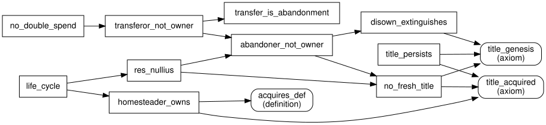

# Technical notes — v0.23

These notes are for readers who want the reasons behind the axioms and the proof ideas behind the main theorems. [README.md](README.md) gives the plain-language account, [VERIFICATION.md](VERIFICATION.md) gives the machine record, and [ARGUMENT.md](ARGUMENT.md) makes the philosophical case.

## 1. The design principle

`owns(P,O,Q,M,T)` (*P may exclude Q from using O in manner M at T*) is the only normative primitive. In Hohfeld's terms it is a claim of P against Q, correlative to Q's duty not to use O in M without P's consent. An owner also holds powers over his titles: to waive one for a single use (`consents`), to give one up (`disowns`) and to give one to another person (`grants`). Ownership in the usual sense is the pattern "a claim against every other person in every manner" (`full_owner`). Everything else that is normative is defined from these:

```
may_use(Q,O,M,T)      <=> ![R]: ((owns(R,O,Q,M,T) & ~ forfeits(R,O,Q,T)) => consents(R,O,Q,M,T))
forbidden_use(Q,O,M,T) <=> ~ may_use(Q,O,M,T)
aggresses_in(P,Q,M,T)  <=> ?[O]: (use(P,O,M,T) & owns(Q,O,P,M,T) & ~ forfeits(Q,O,P,T) & ~ consents(Q,O,P,M,T))
aggresses(P,Q,T)       <=> ?[M]: aggresses_in(P,Q,M,T)
forfeits(R,O,Q,T)      <=> ?[M]: (aggresses_in(R,Q,M,T) & ((O = R) | use(R,O,M,T)))
permissible(P,M,T)     <=> ![O]: (use(P,O,M,T) => may_use(P,O,M,T))
```

Three consequences of this form carry most of the weight:

- **No self-exclusion.** `owns_typing` requires `P != Q`, so nobody holds a title against himself, and the owner's own consent never enters his permission.
- **Partial titles bite exactly where they reach.** A person whom nobody may exclude may use the thing, whatever the owners say to others (`unexcluded_use`, scenario `partial_title_no_veto`).
- **No privilege to use.** An owner's permission to use his own property is the residue of other people's titles. It holds when nobody else holds a title against him over the thing, and the titles over the other things that the same action uses limit it, action by action (`ownership_is_not_licence`, `action_liberty`).

## 2. Changes in v0.22

### 2.1 Titles per manner

v0.21 titles covered every manner at once, so a lease or a right of way could not be stated: the only way to let Ben walk across the field without asking was to release the whole title against him. v0.22 adds the manner to `owns`, `disowns`, `grants` and `acquires`. Homesteading still yields titles in every manner (the homestead case of `acquires_def` does not depend on the manner), so `homesteader_full_owner` holds. Two patterns follow without new axioms:

- **Lease** = `transfers_manner`: share manner M (grant every M-title held, and an M-title against oneself) and release every M-title. `lease_tenant_excludes_landlord` and `lessor_loses_manner` state the result; titles in other manners are untouched.
- **Easement** = one release, `disowns(R,O,E,M,T)`. `easement_use` states the result.

The end of a lease is not modelled: the landlord recovers the leased manners only by a grant back, which the tenant owes by contract. Contract is outside the theory.

### 2.2 Acceptance

A grant takes effect only if the grantee accepts it: `acquires_def` requires `accepts(P,R,O,T)`. `no_title_without_acceptance`: apart from homesteading, every title over an object goes back to an acceptance. Acceptance covers the grants made to the acceptor. It does not protect a buyer against the seller granting a title against him to someone else: the seller held that title and may pass it on (`joint_purchase`). A buyer who expected sole ownership has a complaint in contract.

### 2.3 Defence by forfeiture

v0.21 classified defensive force as aggression: if Ada hits Ben and Ben blocks her, both used the other's body without consent. v0.22 adds one definition, `forfeits_def`. While R aggresses against Q in manner M, R forfeits, with respect to Q only, his titles over his own body and over the things that he uses in that same action. `may_use_def` and `aggresses_in_def` ignore forfeited titles. Results:

- `defence_is_not_aggression`: a victim who, against the aggressor, uses only the aggressor's body and the things used in the aggression does not aggress against him.
- `fight_one_aggressor`: when each of two persons uses only the other's body, `aggresses(P,Q,T) <=> ~ aggresses(Q,P,T)`.

`aggresses_in` and `forfeits` are defined in terms of each other, so together they are an implicit fixed point, not an explicit definition. P's aggression against Q depends negatively on Q's aggression against P, and that depends negatively on P's aggression against Q. Every cycle in the dependency graph therefore alternates between the two directions and passes through an even number of negations. Titles do not depend on aggression at all. For a finite world, this is the situation of a call-consistent logic program, whose completion is consistent (Sato 1990), so a solution exists; the fight case shows that it need not be unique. This general argument is a proof sketch; the story world and the scenarios confirm particular cases. The two solutions correspond to the two answers to "who started it?", which an instant-based theory cannot see. Proportionality is not modelled: during the aggression the victim may use the aggressor's body in any manner.

The forfeit applies only to the things used in the *aggressing action*, that is, in the same manner. If Ada plows her field while she pushes Cy, Cy gains no licence over the field, because the plowing is a different action.

### 2.4 The direction view (LiquidZulu)

LiquidZulu's argument against group ownership (course text "On the Impossibility of Group Ownership") defines ownership as direction and asserts that in a conflict between two owners, "either A is said to be the just victor, or B is". The contrast axiom `direction_exhaustive` states this premise as he states it, for a conflict between two owners of a thing (each holds at least one title over it). It has one effect:

- `direction_forbids_deadlock`: two co-owners who refuse each other, with clashing wants, contradict the premise.

Sole ownership is untouched: with the premise added, a sole owner may still refuse two rivals who want clashing uses (scenario `owner_refuses_two_rivals_under_direction_view`). The premise therefore removes exactly the outcome that the exclusion view adds, the deadlock in which neither co-owner may proceed without the other. It follows from defining ownership as direction (if to own is to direct, settling a dispute between owners means saying whose direction holds), so it is not independent support for that definition. Without the premise, the deadlock has models (scenario `co_ownership_consistent`).

(v0.22 stated the premise for every conflict between two persons and derived that an owner could never refuse two rivals, `direction_overreach`. That reading generalized LiquidZulu's premise beyond what he asserts; v0.23 corrects it and removes the theorem.)

### 2.5 Veto co-ownership and free-use co-ownership (v0.23)

Legal systems usually give each co-owner free use of the whole. In the theory, that is the pattern in which the co-owners hold titles against outsiders only. "Free use" then has two readings:

- **Bare permission.** Nobody holds a title against either co-owner, so two clashing uses are both permitted, while `clash_factual` lets at most one happen (`free_use_unsettled`). The pattern is consistent, but the titles do not settle the conflict: the scenarios `free_use_ada_acts_first` and `free_use_ben_acts_first` have opposite outcomes, and neither contains aggression. Which use goes ahead depends on who acts first. Effects that persist in time (a planted crop) are not protected either, unless a rule about products makes the crop a separate title, and the theory has no such rule yet.
- **Guarantee.** Each co-owner's use is protected against interference by the others (no ouster; Italian civil code art. 1102). That is the control view restricted to co-owners, and when their wants clash it is contradictory (`control_coownership_contradiction`).

Either way the parties cannot both have the free use the law appears to grant. A decision outside the titles (a majority, a court, a sale) must settle who may use the thing. In the veto form, by contrast, two uses by co-owners are both permitted only if each consents to the other's (`veto_settles_conflict`). Every conflict between co-owners has an answer given by the titles alone.

## 3. Grants replace transfer (v0.21; shown without the manner argument)

v0.20 had one way to pass title: `vol_transfer(P1,P2,O,T)`, which moved *all* the transferor's titles to *one* transferee, with `transfer_functional` forbidding two transferees at one instant. Two ordinary ways of becoming co-owners were therefore inexpressible: a sole owner giving away a share while keeping his own, and two people buying together. The second was even classified as a "double spend". Both are ordinary libertarian transactions; the defect lay in taking the whole-object transfer as primitive.

v0.21 takes the single title as the unit of alienation:

```
grants(R,P,O,Q,T)        R grants P the right to exclude Q from O; R keeps his own titles
grant_typing:            grants(R,P,O,Q,T) => is_owner(R,O,T) & np_obj(O) & person(P) & R != P
acquires_def (2nd case): ?[R]: (grants(R,P,O,Q,T) & (owns(R,O,Q,T) | Q = R))
gives_share(R,P,O,T)  <=> grants(R,P,O,R,T) & ![Q]: ((owns(R,O,Q,T) & Q != P) => grants(R,P,O,Q,T))
vol_transfer(R,P,O,T) <=> gives_share(R,P,O,T) & abandons(R,O,T)
```

- A grant conveys only a title that R holds, or a title against R himself (`grant_conveys`, `nemo_dat`). Granting a title against oneself is self-binding, and only an owner may do it (`grant_typing`); otherwise a person with no title could make an unowned object owned by granting a friend a title against himself.
- Duplicating a title does not wrong third parties. Before a share gift, Cy needs Ada's consent; afterwards he needs Ada's and Ben's. Cy had no claim to use the field in either case, and the only power lost is Ada's power to permit Cy alone, which she gave up voluntarily.
- `share_gift`, `joint_purchase` (two transfers at one instant) and the old transfer theorems (`transferee_owns`, `transferor_not_owner`) follow. `transfer_relinquishes` and `transfer_functional` are gone; `transfer_is_abandonment` holds by definition.
- `no_double_spend` now says the right thing: after a transfer, the former owner can grant nothing at all, because `grant_typing` requires him to be an owner. Selling to two persons at once is a joint purchase. If either buyer expected sole ownership, his complaint lies in contract.
- Inalienability of the body is now `voluntary_slavery_impossible`: nobody can grant any title over a body (`grant_typing` requires an object).

## 4. Control, and the "de facto owner" objection (v0.21)

The objection: if A wants the thing idle and B wants to use it, the thing stays idle; A's will prevails, so A is the de facto owner. The theory makes "prevails" precise with a defined notion of control:

```
controls(P,O,T) <=> (![M]: may_use(P,O,M,T)) & ![Q,M]: ((person(Q) & Q != P) => (may_use(Q,O,M,T) <=> consents(P,O,Q,M,T)))
```

- `sole_owner_controls`: a sole owner (nobody may exclude him; he alone may exclude every other person) controls the thing. The control view describes this special case correctly, and the error lies only in generalising it into a definition of ownership.
- `control_needs_deference`: if A controls O and B may exclude A, then B consents to every use by A. A co-owner controls only by the others' leave.
- `unanimity`: with two co-owners holding the only titles against C, C may use the thing iff both consent.
- Scenario `idleness_is_not_control`: A wants nothing at t1, B wants to plow, and both refuse each other everything. At t1 every want of A is met and B's is not. At t2 A wants to sow and B's refusal frustrates her. At neither instant does either control the field.

The asymmetry the objection relies on comes from the fact that refraining needs no consent (`refraining_innocent`). Under any veto rule, the party who wants the least gets his way; that is a property of unanimity, and it gives that party no power over anyone else's use. Each co-owner's stance is a consent set ("I exclude every use except X"); the permitted uses are the intersection; an empty intersection means idle property, which is a cost and not a contradiction.

## 5. Changes from v0.19 to v0.20, and why

### 5.1 A defect: the veto ignored whom the owner could exclude

v0.19 had

```
use_veto: (is_owner(R,O,T) & ~ consents(R,O,Q,M,T)) => forbidden_use(Q,O,M,T)
```

`is_owner(R,O,T)` holds if R may exclude *anyone* from O. So an owner who had released his title against Ben, but kept one against Cy, could still forbid Ben. Z3 confirmed this on the v0.19 encoding: with nobody holding a title against Ben, Ben was still forbidden whenever the partial owner withheld consent. The relational index of `owns` was inert in the deontic layer. The fix keys the veto on `owns(R,O,Q,T)`; with that, `use_grant`, `use_veto`, `use_liberty` and `self_consent` collapse into the single definition `may_use_def`.

### 5.2 Axioms that became theorems

| v0.19 axiom | v0.20 status |
|---|---|
| `anti_slavery` | theorem `person_unownable` (from `owns_typing` + `entity_disjoint`) |
| `ownership_persistence` | theorem `title_persists` (stronger: half-open release window) |
| `disown_extinguishes` (with the undefined oracle `reacquires`) | theorem `disown_extinguishes`; the oracle is replaced by "no acquisition event in (T1,T2)" |
| `self_consent` | unnecessary (no self-exclusion, §1) |
| `use_liberty`, `use_grant`, `use_veto` | definitions `may_use_def`, `forbidden_use_def` |
| `homesteading`, `vol_transfer_conveys`, `vol_transfer_grants_vs_transferor` | one axiom `title_acquired` over the definition `acquires_def` |
| `excl_o_symmetric` | removed: `clash_factual` is already symmetric in its two use-events |

The title axioms are now a matched pair over one notion of *acquisition event* (shown in its v0.20 form; v0.21 replaces the transfer case by grants, §2):

```
acquires(P,O,Q,T) <=> (?[M]: (rivalrous(O) & use(P,O,M,T) & claim(P,O,T) & unowned(O,T)))
                    | (?[R]: (vol_transfer(R,P,O,T) & (owns(R,O,Q,T) | Q = R)))
title_acquired:  acquires(P,O,Q,T1) & person(Q) & P != Q & T1 < T2 & nodis_upto(P,O,Q,T1,T2) => owns(P,O,Q,T2)
title_genesis:   owns(P,O,Q,T2) & np_obj(O) => ?[T1]: (T1 < T2 & acquires(P,O,Q,T1) & nodis_upto(P,O,Q,T1,T2))
```

Read together they say: *a title over an object holds at T2 if and only if an acquisition event for it occurred earlier and the title has not been released since.* Persistence and extinction are then consequences. For persistence: genesis at T1 supplies an event at T0 < T1 with no release in [T0,T1); add "no release in [T1,T2)" and `title_acquired` fires at T2. For extinction: a release at T1 lies inside [T0,T2) for every event at T0 ≤ T1, so only an event strictly after T1 can ground the title at T2.



*Figure. Which theorems the proofs of the title theorems use. An arrow A → B means: the proof of A uses B. Rounded boxes are axioms or definitions. Generated from `source/theory.py`.*

### 5.3 Predicates removed

- `excl` and `excl_global`: a manner incompatibility "on every object" would make every object scarce, including ideas. Only the object-relative `clash` (formerly `excl_o`) remains.
- `rivalrous` is now *defined*: `rivalrous(O) <=> ?[M1,M2]: clash(O,M1,M2)`. Scarcity is the possibility of conflict, which is the reason the theory gives for titles at all.
- `may_claim`, `may_disown`, `may_transfer` and their three permission axioms. These predicates occurred only positively, in the consequents of their own axioms. Every model of the rest extends to them by making them true everywhere, so removing them changes no consequence about anything else. The power to transfer or abandon is expressed by the typing axioms: the only precondition of a transfer or a release is holding the title.
- `nodis` (closed window): every statement now uses the half-open `nodis_upto`.
- `reacquires`: replaced by the defined `acquires`.

Counts: v0.19 had 41 axiom statements, one unconstrained oracle and 38 theorem files (one of which, `theft_retains_ownership`, used an undeclared predicate `allows`). v0.20 had 21 axioms, 11 definitions and 40 theorems; v0.21 has 19 axioms, 14 definitions and 45 theorems, each proved by two provers from a declared minimal premise set.

### 5.4 Abandonment and transfer unified

`transfer_is_abandonment`: a transfer releases every title the transferor holds, so it *is* an abandonment, with a designated successor. `transferor_not_owner` is now a two-line corollary of `abandoner_not_owner`, and `no_double_spend` a corollary of that.

## 6. The co-ownership result

**Exclusion view.** Let A and B co-own O at T: for every manner M, `owns(A,O,B,M,T) & owns(B,O,A,M,T)`. Suppose each refuses the other every manner, A wants M1, B wants M2, and `clash(O,M1,M2)`. Then `forbidden_use(A,O,M1,T)` and `forbidden_use(B,O,M2,T)` (`joint_deadlock`). Both titles are respected if neither uses O. Nothing in the theory forces either to act, so the situation has models: Z3 (`co_ownership_consistent`, with "no aggression anywhere" added), Vampire (`models/B_co_ownership`), and the story world (t1–t3).

**Control view.** Add

```
control_use_liberty: is_owner(P,O,T) => may_use(P,O,M,T)
control_protection:  is_owner(P,O,T) & wants(P,O,M1,T) & clash(O,M1,M2) & person(Q) & Q != P
                     => forbidden_use(Q,O,M2,T)
```

- With `control_use_liberty` alone: B is an owner, so `may_use(B,O,M,T)`; by `may_use_def`, every R with a title against B consents. So, absent aggression, `owns(A,O,B,M,T) & is_owner(B,O,T) => consents(A,O,B,M,T)` (`control_no_refusal`). The co-owners' titles against each other become empty: neither can ever exclude the other.
- With both: if A wants M1 and `clash(O,M1,M2)`, then B is forbidden M2 by protection and permitted M2 by liberty. Hence `~(is_owner(A,O,T) & is_owner(B,O,T) & A != B & wants(A,O,M1,T) & clash(O,M1,M2))` (`control_coownership_contradiction`). Only A's want is needed. Since the theory places no constraint on wants, the configuration is satisfiable in the base theory; with the control axioms it is refuted (Z3 and Vampire). With a sole owner it remains satisfiable (`sole_ownership_under_control_view`).

So the classical argument that ownership must be exclusive is valid relative to the control conception. The contradiction comes from the two control axioms together, applied between co-owners. In Hohfeld's terms it is the clash of A's claim against B's use with B's privilege to make that use. Each control axiom alone is consistent with co-ownership, and so is the pair when the protection applies only against non-owners (scenarios `co_ownership_with_use_liberty_only`, `co_ownership_with_protection_only`, `co_ownership_with_protection_against_outsiders`). Under the control view, rights can conflict at a single instant even when nobody does anything; under the exclusion view, they cannot.

## 7. Compossibility (proof sketch, not machine-checked)

*Claim.* For any model 𝔐 of the theory with finite time and any instant T*, there is a model 𝔐′ that agrees with 𝔐 before T* and in which nobody aggresses at or after T*.

*Construction.* Delete every `use` fact at instants ≥ T*. Recompute titles at instants > T* by the recursion that the title axioms define (each instant depends only on earlier ones). Delete each grant whose granter is no longer an owner, and each release whose title no longer exists. Keep everything else.

*Check.* Titles before T* are unchanged. Typing holds by construction. `clash_factual` only forbids pairs of uses, and there are fewer uses. The title axioms hold by the recursion. Titles after T* are a subset of the old ones, because only acquisition events were removed, so `unowned_exists` still holds. With no use at or after T*, `aggresses` is false there.

The theorem `refraining_innocent` is the instant-level core of this argument.

## 8. Time: the theory needs a first instant

`endless_past_paradox` (proved by both provers): if every instant has an earlier one, and P uses and claims a scarce O at every instant with no grants or releases, the axioms are contradictory. Let U be the set of instants at which O is unowned. Because P homesteads at every instant of U, O is owned at every instant after an element of U. By genesis, O is unowned at T exactly when no element of U lies before T. If U is empty, every instant qualifies, so U is not empty. If u is in U, no element of U lies before u. An instant s before u (one exists, since there is no first instant) then has no element of U before it, so s is in U; but then u is not. The structure is that of Yablo's paradox: each instant's status refers only to earlier instants, and with no first instant there is no base case.

First-order logic cannot state well-foundedness, so no axiom can exclude these orders completely. Every finite model is well founded, and so is every real history that has a beginning. The theory should be read as a theory of such histories. The rule "the first user owns" presupposes that "first" exists.

## 9. Open questions

See [ROADMAP.md](ROADMAP.md). The ones closest to the co-ownership theme are: deadlock-breaking (partition, buy-out, majority rules agreed by contract), consent that lasts over time, and bilateral exchange.
